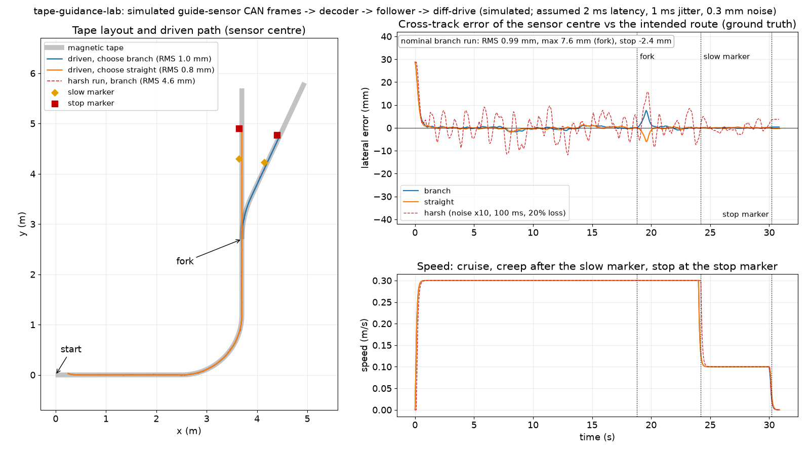
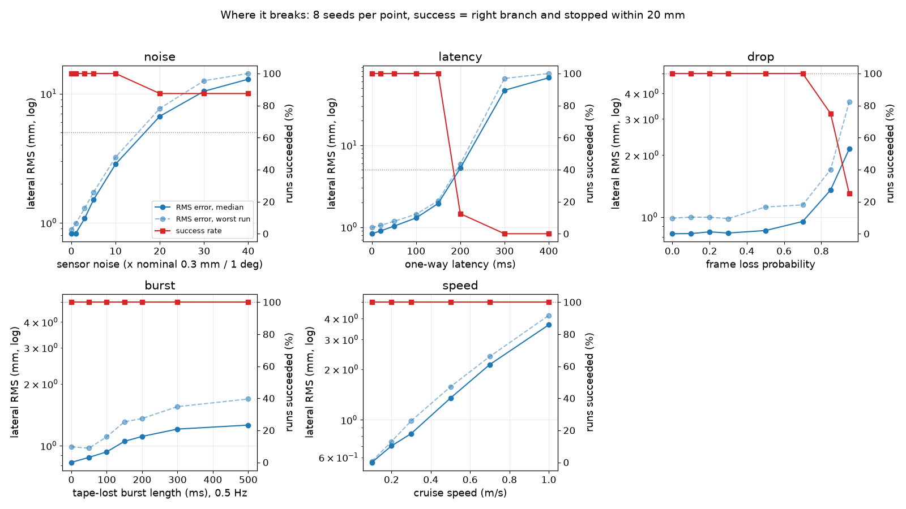
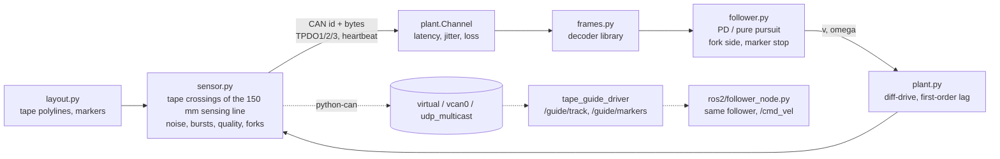

# tape-guidance-lab

An open magnetic-tape AGV guidance stack that runs without hardware: an open CANopen "guide sensor" profile, a sensor simulator that emits it, a decoder library, a ROS 2 Jazzy driver, and a line follower with fork choice and stop-marker handling, all tested in closed loop against a simulated differential-drive robot.



Everything here is simulated and labelled as such. No hardware implements the profile yet (see "What is not verified yet").

## What it does

- **Sensor profile** ([`docs/PROTOCOL.md`](docs/PROTOCOL.md)): COB-IDs, PDO layouts, scaling, flags for track detected / fork / merge / junction / left and right marker, heartbeat and an object table, designed from general CANopen practice (CiA 301). An EDS-style file is generated by `python -m agvlab eds` ([`docs/tape-guide-sensor.eds`](docs/tape-guide-sensor.eds)).
- **Sensor simulator** (`agvlab/sensor.py`): turns a robot pose and a tape layout into the profile's CAN frames, with noise, quantisation, dropouts and forks.
- **Decoder library** (`agvlab/frames.py`): encoder, decoder and object dictionary of the profile, no ROS or hardware dependency.
- **ROS 2 Jazzy driver** (`ros2/src/tape_guide_driver`, messages in `ros2/src/guide_msgs`): reads the frames from a python-can bus and publishes `/guide/track`, `/guide/markers`, `/guide/state`.
- **Line follower** (`agvlab/follower.py`): PD plus curvature feed-forward, picks the left or right track at a fork, slows at the first marker and brakes onto the second. Runs inside a ROS 2 node (`ros2/follower_node.py`, `/cmd_vel`) and standalone.
- **Lab** (`agvlab/lab.py`, `sweep.py`, `live.py`): physics (unicycle with velocity lag), channel model (latency, jitter, loss), metrics, break-point sweeps, and a real-time run over python-can (`virtual`, SocketCAN `vcan0`, `udp_multicast`).

## Results

All numbers are from runs of this repository on simulated data. Simulated-time numbers are deterministic (seeded) and reproduce with the commands below. Layout: 2.5 m straight, 90 degree curve (R 1.2 m), 1.5 m straight, a fork (25 degree branch), a slow marker and a stop marker on each route; 0.3 m/s cruise, 0.1 m/s creep; start 20 mm and 2 degrees off the tape. Sensor and channel parameters are assumptions (listed below).

| | Result | Where from |
|---|---|---|
| Tracking RMS lateral error (ground truth, sensor centre vs route) | **0.83 mm** median, 0.99 mm worst of 8 seeds | `docs/results.json`, noise sweep at x1 |
| Max lateral error | 7.6 mm worst of 8 seeds (the hand-over at the fork) | same |
| Junction choice | **8 of 8 runs correct** (8 seeds, 4 per branch); first wrong choices at 300 ms latency (75% correct), 400 ms: 12% | sweeps |
| Stop accuracy at the stop marker | **2.1 mm** median error, 2.6 mm worst of 8; stays under the 20 mm bar up to 150 ms latency | sweeps |
| TPDO1 frame rate, real time, python-can `virtual` and SocketCAN `vcan0` (GitHub Linux runner, 10 s) | **100.1 Hz** on both (interval mean 9.99 ms, sd 0.17 ms, max 10.4 ms) | CI artifact `core-results` |
| ROS 2 closed loop through the driver in this repository (real time, `ros:jazzy-ros-base` container) | RMS 0.94 mm (branch) and 0.77 mm (straight), stop error -2.1 mm and -1.0 mm, both junctions correct; `/guide/track` at **100.0 Hz** (interval sd 0.18 ms and 0.33 ms) | CI artifact `ros-results` |

Controller comparison on the same route and seed (branch, seed 0): the follower here gives 0.99 mm RMS; a pure-pursuit variant on the lateral offset gives 12.6 mm; a naive P-only law (`omega = 5*pos + 1*heading`, 0.15 m/s, no marker handling) gives 7.0 mm and never stops. Same gains for every run, nothing tuned per scenario.

The real-time rows come from one CI run (run 42520647100 of this repository: 145 tests passed on Python 3.10 and 3.12, ROS job green). The SocketCAN row needs the `vcan` kernel module, which the hosted runner provided that time.

## Where it breaks

8 seeds per point, routes alternate branch and straight. Success = right branch and stopped within 20 mm of the marker. Full table: `docs/results.json`; plot: `docs/sweep.png`.

| Sweep | Tracking | Stop marker | Junction | Breaks at |
|---|---|---|---|---|
| Sensor noise (x nominal 0.3 mm / 1 deg) | RMS 2.9 mm at x10, 6.7 mm at x20 | stop error 3.8 mm worst, but one of 8 runs misses the stop from x20 | correct to x40 | RMS passes 5 mm between x10 and x20; one run in eight fails from x20 |
| One-way latency | RMS 1.9 mm at 150 ms, 5.3 mm at 200 ms | stop error is about 0.1 x latency: 10.5 mm at 100 ms, 20.3 mm at 200 ms | 100% to 200 ms, 75% at 300, 12% at 400 | **stop accuracy fails at 200 ms, the junction at 300 ms** |
| Frame loss | RMS 0.95 mm at 70% loss | 5.2 mm median at 70%, 12.4 mm at 85% | correct throughout | success 75% at 85% loss, 25% at 95% |
| Tape-lost bursts (0.5 Hz) | RMS 1.1-1.3 mm | a burst that hides the stop marker costs up to 12 mm (300 ms) and 19 mm (500 ms) | correct throughout | none up to 500 ms in these 8 seeds, but the stop margin is gone at 500 ms |
| Cruise speed | RMS 0.56 mm at 0.1 m/s, 3.7 mm at 1.0 m/s | 2.5 mm worst, all speeds | correct throughout | does not break up to 1.0 m/s |



The follower tolerates a lot of noise and loss because the controller is low-pass and the stop profile dead-reckons between marker frames. What it does not tolerate is delay: the stop profile uses the marker offset from TPDO2 and the robot keeps moving while the frame is in flight.

## Quick start

```bash
python -m venv .venv && . .venv/bin/activate      # .venv\Scripts\activate on Windows
pip install -e .[dev]                             # numpy, python-can, matplotlib, pytest, ruff
python -m pytest -q                               # 145 tests
python -m agvlab run                              # demo: one closed-loop scenario, prints the metrics
python -m agvlab run --route straight --latency-ms 200 --drop 0.3 --noise-x 10
python -m agvlab candump --duration 0.1           # the simulator's frames, candump -l style
python -m agvlab sweep --seeds 8                  # all sweeps -> docs/results.json (several minutes)
python -m agvlab figure --post docs/post-figure.png --sweeps docs/results.json
python -m agvlab eds                              # object dictionary -> docs/tape-guide-sensor.eds
python -m agvlab live --interface virtual --channel lab --duration 10
```

Sample `candump` output (node 21, frames a driver sees on `0x195` / `0x295` / `0x395` / `0x715`):

```
(0.004132) vcan0 195#E1FEE1FEFCFC01C8
(0.004132) vcan0 295#0080008000800080
(0.004132) vcan0 395#010000
(0.004132) vcan0 715#05
(0.023295) vcan0 195#E4FEE4FEFCFC01C8
```

The first line: offset -28.7 mm on both slots (single tape, 20 mm start offset plus 2 degrees yaw seen 0.25 m ahead), heading -2.0 degrees, flags `0x01` (track), quality 100 %. The marker frame is all `0x8000` (no marker). On Linux with SocketCAN:

```bash
sudo modprobe vcan && sudo ip link add dev vcan0 type vcan && sudo ip link set up vcan0
python -m agvlab live --interface socketcan --channel vcan0 --duration 10
# in another terminal: candump vcan0
```

ROS 2 (Jazzy), same script as CI, in the official container:

```bash
docker run --rm -v "$PWD":/repo -v "$PWD/results/ros":/out -e REPO=/repo -e OUT=/out \
    ros:jazzy-ros-base bash /repo/ros2/run_in_container.sh
```

## How it works



1. **Layout** (`agvlab/layout.py`): tape polylines from line and arc segments, a fork whose branch leaves the spine, and a slow marker and a stop marker 55 mm left of the tape on each route.
2. **Sensor** (`agvlab/sensor.py`): finds where each tape crosses the 150 mm sensing line 0.25 m ahead of the axle, gives the lateral offset (left positive) and the heading (counter-clockwise positive), merges tapes closer than 12 mm, reports the leftmost and the rightmost track (identical on a single tape), and encodes TPDO1 (100 Hz), TPDO2 (50 Hz), TPDO3 (20 Hz) and the heartbeat (1 Hz). Noise is Gaussian before quantisation to 0.1 mm / 0.5 degree; markers are quantised to 0.25 mm; bursts blank the sensor like a magnetic glitch.
3. **Channel and plant** (`agvlab/plant.py`): frames are delayed, jittered and dropped in simulated time, preserving bus order. The robot is a unicycle with a 0.1 s velocity lag.
4. **Follower** (`agvlab/follower.py`, no ROS): decodes the frames and runs one of three controllers. The default is PD on the lateral offset plus a curvature feed-forward `v * heading / L`. It follows the left or right reported track to choose the fork branch, drops to creep speed on the first marker edge, and brakes with `v = sqrt(2*a*d)` on the second, dead-reckoning between TPDO2 frames. Marker edges closer than 0.3 m of commanded travel count as one marker, so a sensor dropout in the middle of a marker does not count it twice.
5. **Metrics** (`agvlab/lab.py`): RMS and max lateral error against the intended route (ground truth, from t = 1 s so the 20 mm start offset does not dominate), junction correctness (final position nearest the intended branch, past the fork), stop error along the heading at the marker, achieved TPDO1 rate.
6. **Real bus** (`agvlab/live.py`): the same loop in wall-clock time over two python-can `Bus` objects on one channel.
7. **ROS 2** (`ros2/`): `sim_node.py` runs plant plus simulated sensor and writes CAN frames; the driver turns them into `guide_msgs/Track` and `guide_msgs/Markers`; `follower_node.py` closes the loop on `/cmd_vel`. `check_results.py` asserts: ran to the stop, right branch, RMS under 10 mm, stop within 40 mm, `/guide/track` between 80 and 120 Hz, both markers seen. The thresholds are loose on purpose: DDS, Python and a shared CI runner add jitter that the simulated-time numbers do not have.

## Tests and CI

`pytest -p no:asyncio` (set in `pyproject.toml`), 145 tests: frame layouts with pinned byte vectors, wrong-length handling, object-dictionary and PDO-mapping consistency, layout geometry, the sensor model (offset and heading sign, quality ramp, two tracks, fork and merge flags, markers, periods, noise, bursts), channel and plant, every follower branch (lost tape, hold, fork side, marker debounce, stop latch), closed-loop runs, sweeps, the CLI, both figures, the driver's message conversions, and real-time runs over python-can (the real-time rate tests skip on a host whose timer is too coarse).

GitHub Actions (`.github/workflows/ci.yml`):

- **core**: Python 3.10 and 3.12 on ubuntu-24.04, `ruff check`, the full test suite, a best-effort `vcan0` set-up (the SocketCAN test skips if the runner has no `vcan` module), a 10 s real-time rate measurement on `virtual` and `vcan0`, a quick sweep. Results are uploaded as an artifact.
- **ros2-jazzy**: `ros:jazzy-ros-base` container, `colcon build` of `guide_msgs` and `tape_guide_driver`, closed loop for both junction choices.

## Data sources

None. Every sensor reading is generated by the simulator; there is no real-world data in this repository.

## What is not verified yet

- **No real sensor or tape was used, and no hardware implements this profile.** Everything the follower sees comes from the simulator. The profile is this repository's design; its scalings (0.1 mm, 0.5 degree, 0.05 mm) fit a 150 mm sensing width but have not been checked against any physical sensor array.
- **All sensor numbers are assumptions**: 150 mm sensing width, 70 mm detection limit with a linear quality ramp from 35 mm, 0.3 mm rms offset noise, 1 degree rms heading noise, 12 mm tape merge distance, 40 mm marker window, 0.25 mm marker resolution. There is no recorded data behind them.
- **Channel timing is assumed**: 2 ms latency and 1 ms half-normal jitter. A real CAN adapter, kernel and driver have burstier timing; the break-point sweeps vary latency, jitter is not swept.
- **Fork and merge flag semantics** are defined by the profile and set by the simulator when two tapes diverge or converge; the follower does not rely on them (it picks a branch by following the left or right track).
- **Intersections** are only flagged for tapes crossing the sensing line steeper than 60 degrees; a tape lying along the sensing line (a true broad crossing) is not modelled. SDO, NMT command, SYNC and EMCY traffic are documented in the protocol but not simulated.
- **Plant.** A kinematic unicycle with a first-order lag: no wheel slip, no payload, no floor irregularities. The stop numbers assume the follower's lag compensation (0.1 s) matches the plant, which it does here by construction.
- **vcan0 in CI is best effort.** The workflow loads the `vcan` module on the runner; if a runner image lacks it, the SocketCAN test skips and the artifact has no `live_vcan0.txt`.
- **Frame-rate numbers depend on the machine.** The Linux CI numbers are from a hosted runner with an idle bus. On the Windows development laptop the real-time rate was not reproducible (the host timer was too coarse at the time of measuring), so only CI numbers are quoted.
- **Not benchmarked against other follower implementations** beyond the two baselines above, and not tuned per scenario: one set of gains for every run.

## Repository layout

```
agvlab/      frames (profile), layout, sensor, plant, follower, lab, sweep, live, plots, cli
ros2/        src/guide_msgs, src/tape_guide_driver, sim_node, follower_node, lab.launch.py, run_in_container.sh, check_results.py
tests/       145 tests
docs/        PROTOCOL.md, tape-guide-sensor.eds, figure.png, post-figure.png, sweep.png, results.json, linkedin.json
```

## License

MIT, see `LICENSE`. Copyright (c) 2026 Victor Bonilla.
